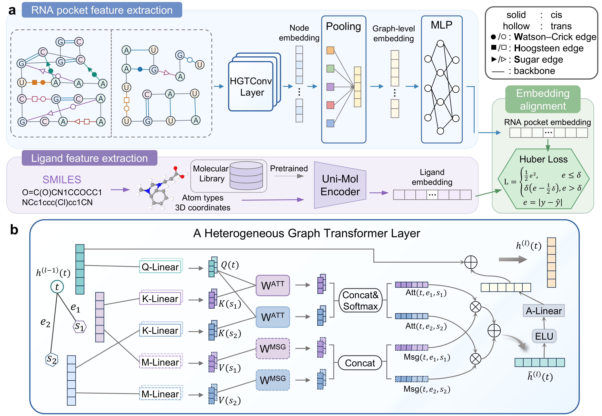

<h1 align="center">RNAchime</h1>

<p align="center"><sub>RNA chemically informed multirelational encoding</sub></p>

## Overview of RNAchime

<p align="center">
  
</p>


## Project structure

```text
RNAchime/
├── .gitignore
├── LICENSE
├── README.md
├── environment.yml
├── figs/
│   └── overview.png
├── data/
│   ├── Dataset_H/
│   ├── Dataset_S/
│   ├── demo/
│   ├── splits/
│   └── shuffled_data/
├── src/
│   ├── rnachime_demo.ipynb
│   ├── train.py
│   ├── learn.py
│   ├── HGTConv.py
│   ├── HGT_loader.py
│   ├── utils.py
│   ├── decoy_evaluation/
│   └── interpretability_mutations/
├── scripts/
├── results/
└── outputs/
```

## Environment setup

Create the Conda environment from [environment.yml](environment.yml):

```bash
conda env create -f environment.yml
conda activate rnachime
```

Check the main runtime dependencies:

```bash
python -c "import torch, dgl; print('PyTorch:', torch.__version__); print('DGL:', dgl.__version__); print('CUDA:', torch.cuda.is_available())"
```

## Notebook demo

[src/rnachime_demo.ipynb](src/rnachime_demo.ipynb) provides a small example using the data under `data/demo`. Environment setup, model training, checkpoint selection, evaluation, and result summaries are explained in the notebook. 

## Training and evaluation

The following workflow trains and evaluates a model on **Dataset S**, which contains 724 annotated RNA pocket graphs with 512-dimensional ligand vectors.

| Input | Path |
| --- | --- |
| Annotated graphs | `data/Dataset_S/annotated/pockets_nx_unimol_all_annot/` |
| External decoy set | `data/Dataset_S/external_decoys/filter_unimol_decoy_dict.p` |
| Training results | `results/S_5fold/unimol_all/` |
| Evaluation results | `outputs/S/unimol_all/` |

### 1. Train

Train five folds for up to 200 epochs each. Each fold trains on four subsets and evaluates on the remaining subset. Early stopping uses validation loss, with a patience of 15 epochs.

```bash
python -u -m src.train \
  --annotated_data data/Dataset_S/annotated/pockets_nx_unimol_all_annot
```

The run folders are created under `results/S_5fold/unimol_all/`:

```text
unimol_all_0_<timestamp>/
unimol_all_1_<timestamp>/
...
unimol_all_4_<timestamp>/
```


### 2. Select the training run

List the saved folders and set the timestamp of the run to evaluate:

```bash
ls results/S_5fold/unimol_all/
export RUN_TIME=20261031_194952
```

Replace the example timestamp with your selected run's timestamp. An explicit `--time` is required when multiple training invocations exist under the same model root. Preserve the underscore between the date and time. Selecting a saved run for evaluation does not retrain the model.

### 3. Evaluate

```bash
python -u -m src.decoy_evaluation.evaluate \
  --annot_graph data/Dataset_S/annotated/pockets_nx_unimol_all_annot \
  --model_root results/S_5fold/unimol_all \
  --time "$RUN_TIME" \
  --decoy_dict_path data/Dataset_S/external_decoys/filter_unimol_decoy_dict.p
```

The evaluator uses each fold's saved test filenames and best checkpoint. 

The current defaults evaluate both candidate pools and save results under `outputs/S/unimol_all/`.

`--decoy_dict_path` is required for `external` and `both`. For `internal`, it can be omitted. 

The generated files are CSV-formatted tables with `.txt` extensions:

```text
outputs/S/unimol_all/
  unimol_all_<timestamp>_internal.txt
  unimol_all_<timestamp>_external.txt
```


## Dataset overview

The datasets provide four ligand representations:

| Ligand embedding | Input directory suffix | Dimensions | Training criterion |
| --- | --- | --- | --- |
| Uni-Mol | `unimol_all_annot` | 512 | `HuberLoss` |
| FP2 | `fp2_all_annot` | 1024 | `BCEWithLogitsLoss` |
| MACCS | `maccs_all_annot` | 166 | `BCEWithLogitsLoss` |
| Morgan | `morgan_all_annot` | 2048 | `BCEWithLogitsLoss` |

## Data preparation and auxiliary scripts

 Additional preparation and analysis tools include:

<table border="1" cellspacing="0" style="border-collapse: collapse;">
  <thead>
    <tr>
      <th style="border: 1px solid #d0d7de; padding: 6px 13px;">Script</th>
      <th style="border: 1px solid #d0d7de; padding: 6px 13px;">Purpose</th>
    </tr>
  </thead>
  <tbody>
    <tr>
      <td style="border: 1px solid #d0d7de; padding: 6px 13px;"><code>binding_pocket_analyse.py</code>, <code>binding_pocket_filter.py</code></td>
      <td style="border: 1px solid #d0d7de; padding: 6px 13px;">Analyze RNA binding pockets and filter pocket–ligand pairs</td>
    </tr>
    <tr>
      <td style="border: 1px solid #d0d7de; padding: 6px 13px;"><code>annotator.py</code></td>
      <td style="border: 1px solid #d0d7de; padding: 6px 13px;">Prepare annotated RNA pocket graphs</td>
    </tr>
    <tr>
      <td style="border: 1px solid #d0d7de; padding: 6px 13px;"><code>build_pocket_graph.py</code></td>
      <td style="border: 1px solid #d0d7de; padding: 6px 13px;">Build RNA pocket graphs</td>
    </tr>
    <tr>
      <td style="border: 1px solid #d0d7de; padding: 6px 13px;"><code>get_sdf.py</code></td>
      <td style="border: 1px solid #d0d7de; padding: 6px 13px;">Download ligand structures in SDF format</td>
    </tr>
    <tr>
      <td style="border: 1px solid #d0d7de; padding: 6px 13px;"><code>pairwise_similarity_us_rmsd.py</code></td>
      <td style="border: 1px solid #d0d7de; padding: 6px 13px;">Compute RNA alignment TM-scores and ligand-position RMSDs using</td>
    </tr>
    <tr>
      <td style="border: 1px solid #d0d7de; padding: 6px 13px;"><code>pairwise_similarity_tversky.py</code></td>
      <td style="border: 1px solid #d0d7de; padding: 6px 13px;">Compute pairwise ligand fingerprint similarity using Tversky coefficients</td>
    </tr>
    <tr>
      <td style="border: 1px solid #d0d7de; padding: 6px 13px;"><code>remove_redundancy.py</code></td>
      <td style="border: 1px solid #d0d7de; padding: 6px 13px;">Remove redundant pockets using RNA, pocket and ligand similarity</td>
    </tr>
    <tr>
      <td style="border: 1px solid #d0d7de; padding: 6px 13px;"><code>rna_type.py</code></td>
      <td style="border: 1px solid #d0d7de; padding: 6px 13px;">Classify binding pockets by RNA type</td>
    </tr>
    <tr>
      <td style="border: 1px solid #d0d7de; padding: 6px 13px;"><code>ligand_embedding/</code></td>
      <td style="border: 1px solid #d0d7de; padding: 6px 13px;">Compute Uni-Mol, Morgan, FP2, and MACCS representations</td>
    </tr>
    <tr>
      <td style="border: 1px solid #d0d7de; padding: 6px 13px;"><code>decoyfinder.py</code></td>
      <td style="border: 1px solid #d0d7de; padding: 6px 13px;">Prepare external decoys</td>
    </tr>
    <tr>
      <td style="border: 1px solid #d0d7de; padding: 6px 13px;"><code>permute_ligands.py</code></td>
      <td style="border: 1px solid #d0d7de; padding: 6px 13px;">Generate frequency-preserving ligand permutations</td>
    </tr>
    <tr>
      <td style="border: 1px solid #d0d7de; padding: 6px 13px;"><code>src/interpretability_mutations/</code></td>
      <td style="border: 1px solid #d0d7de; padding: 6px 13px;">Assess model interpretability through nucleotide mutations</td>
    </tr>
  </tbody>
</table>

## License and Disclaimer

Original RNAchime contributions are licensed under the MIT License; third-party components remain subject to their applicable upstream terms. See [LICENSE](LICENSE) for details.

RNAchime is intended for scientific research and is not intended for clinical diagnosis or treatment. 
